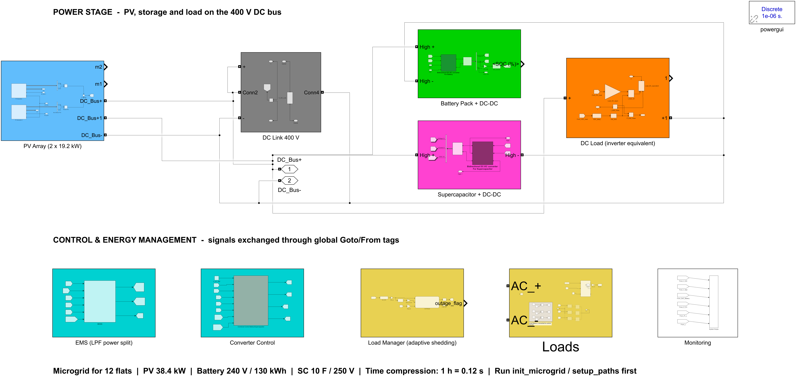
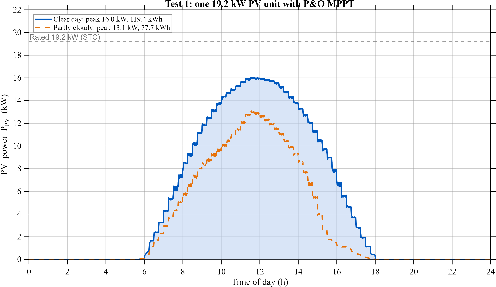
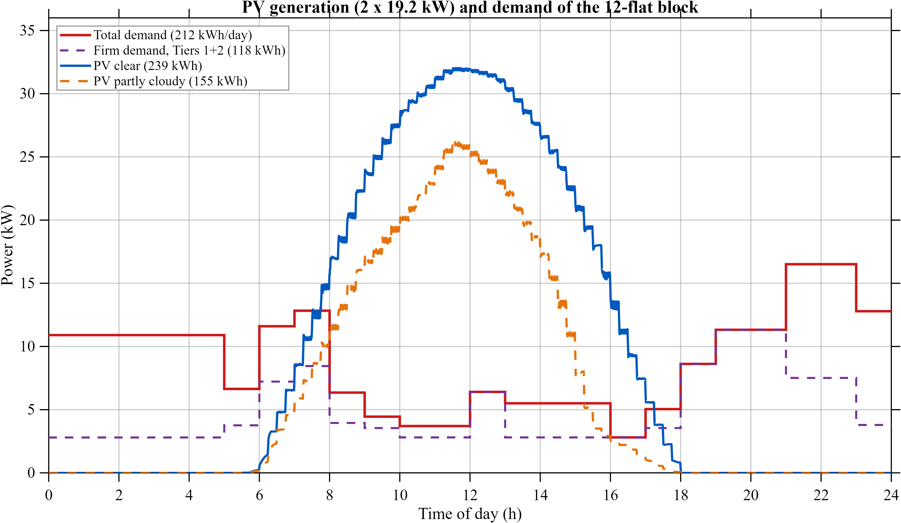
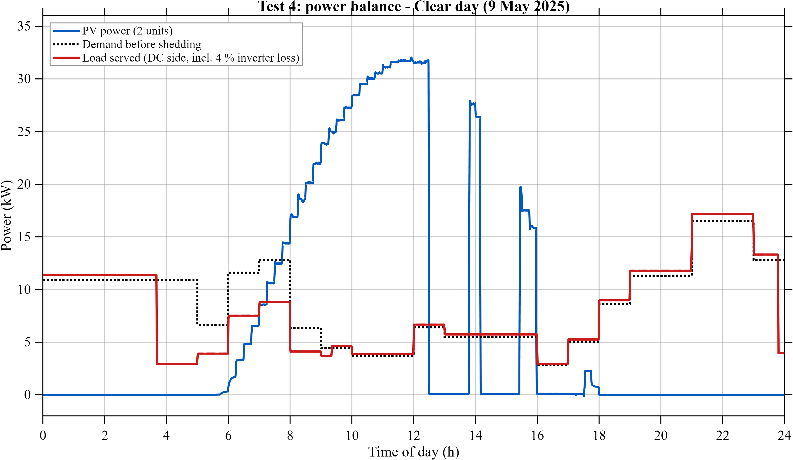
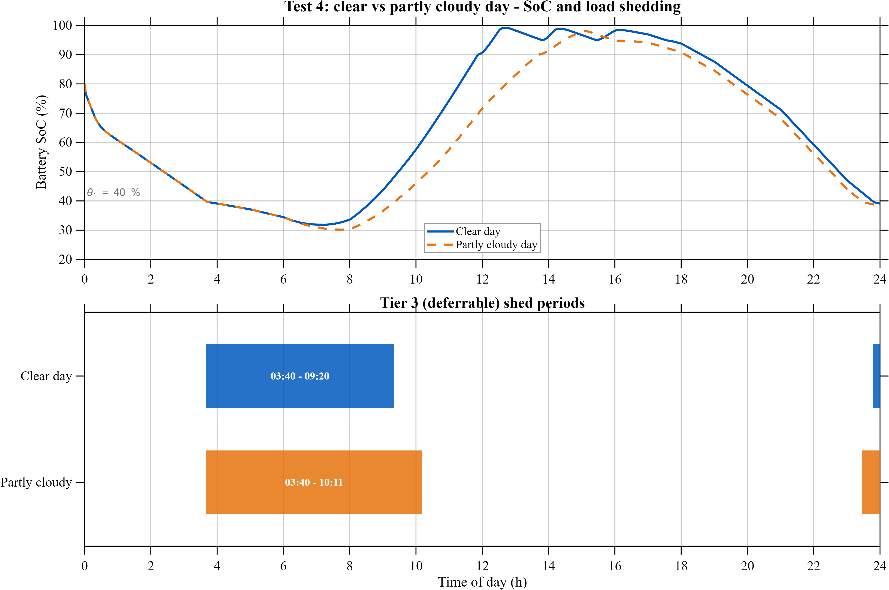
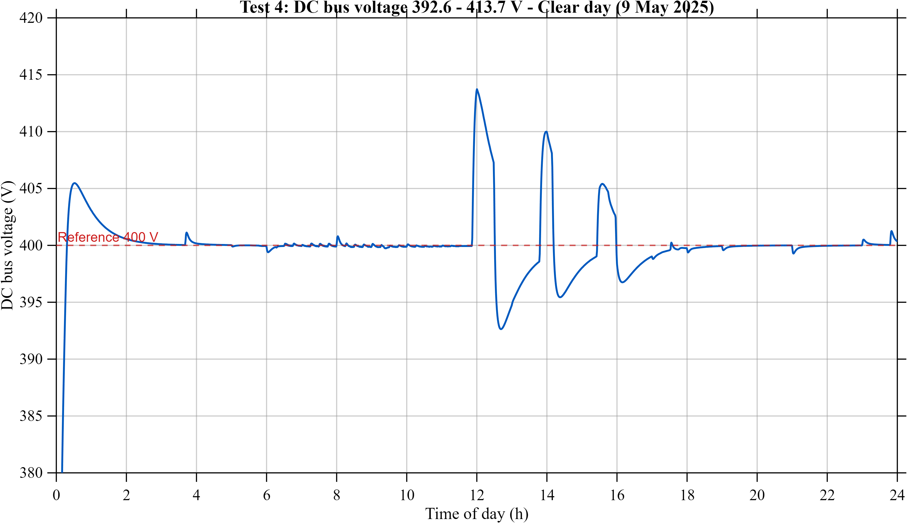
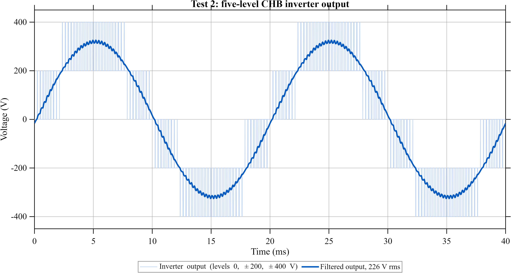

# Smart Renewable Energy Management System with Adaptive Load Shedding

**MATLAB/Simulink solar microgrid for a 12-flat residential block** — 38.4 kW PV with MPPT, battery–supercapacitor storage on a 400 V DC bus, adaptive Stateflow load shedding and a five-level cascaded H-bridge inverter, validated over full days of real NASA POWER weather for Coimbatore, India.

  

> Course project — **23EEE335 Renewable Energy Technologies**, Department of EEE, Amrita School of Engineering, Coimbatore (Group 14)

---

## Team

| Name | Roll number |
|---|---|
| Jeshnu Pranav G | CB.EN.U4EEE24118 |
| Mellacheruvu Sada Siva Surya | CB.EN.U4EEE24128 |
| Mohammed Nihal M | CB.EN.U4EEE24129 |
| Thushar S | CB.EN.U4EEE24150 |

**Guide:** Dr. C. P. Boopathy

---

## System overview



| Subsystem | Design |
|---|---|
| Loads | 12 flats + common loads, appliance-level schedules in 3 priority tiers — 211.6 kWh/day (firm 117.8 kWh), evening peak 16.5 kW |
| PV array | 2 × 19.2 kW units (6S × 8P, 400 W modules), boost converter, perturb & observe MPPT, curtailment at 98 % SoC with hysteresis to 95 % |
| DC bus | 400 V, 25 mF DC link |
| Battery | Li-ion 240 V / 130 kWh (541.7 Ah), SoC window 20–90 %, bidirectional DC–DC, ±156 A |
| Supercapacitor | 10 F / 250 V, bidirectional DC–DC, ±200 A — handles fast power steps |
| Energy management | Low-pass-filter power split: slow power → battery, fast power → supercapacitor; SoC-aware limits; PI bus-voltage loop with anti-windup |
| Load manager | 4-state Stateflow chart (Normal → Shed Tier 3 → Critical only → Outage) with restore hysteresis, driven by battery SoC |
| Inverter | 5-level CHB (2 × 200 V H-bridges), phase-shifted PWM (4 kHz effective), LC filter 2 mH / 20 µF (796 Hz) with 2 Ω damping |

**Weather input:** NASA POWER hourly data, Coimbatore (11.02° N, 76.96° E) — clear day **9 May 2025** (7.32 kWh/m²) and partly cloudy day **16 May 2025** (4.65 kWh/m²), interpolated to 1-minute resolution.

**Time compression:** a full 24-hour day is simulated in 2.88 s (1 real hour = 0.12 s) in the integrated model, and in 1.2 s in the PV unit model.

---

## Results

| Test | Clear day (9 May 2025) | Partly cloudy day (16 May 2025) |
|---|---|---|
| **1 — PV unit** (one 19.2 kW unit) | Peak 16.0 kW, 119.4 kWh/day | Peak 13.1 kW, 77.7 kWh/day |
| **Energy balance** (two units vs 211.6 kWh demand) | 238.9 kWh — 113 % of demand | 155.3 kWh — 73 % of demand |
| **2 — CHB inverter** (4.3 kW load) | 225.8 V rms, 19.1 A rms, voltage THD **0.13 %** up to the 50th harmonic (IEEE 519 limit 8 %) | — |
| **3 + 4 — Integrated 24 h run**: DC bus | 392.6–413.9 V | 395.7–406.9 V |
| Load shedding (Tier 3 only) | 03:40 → 09:20 | 03:40 → 10:11 |
| Critical and essential loads | Never interrupted | Never interrupted |
| Battery SoC | 80 % → min ≈ 32 % → 98 % → 39.1 % | 80 % → min ≈ 30 % → 98 % → 38.3 % |

<table>
<tr>
<td></td>
<td></td>
</tr>
<tr>
<td align="center">PV unit power on both days</td>
<td align="center">Two-unit PV generation vs demand of 12 flats</td>
</tr>
<tr>
<td></td>
<td></td>
</tr>
<tr>
<td align="center">24 h power balance with load shedding (clear day)</td>
<td align="center">Battery SoC and Tier 3 shedding periods, both days</td>
</tr>
<tr>
<td></td>
<td></td>
</tr>
<tr>
<td align="center">400 V DC bus over 24 h</td>
<td align="center">Five-level CHB inverter output</td>
</tr>
</table>

All result figures (white background, 300 dpi) are in [`figures_final/`](figures_final/).

---

## Repository structure

```
├── 01_model/                 Simulink models
│   ├── microgrid_top_fixed.slx   integrated microgrid (Tests 3 and 4)
│   ├── PV_Unit_day.slx           one 19.2 kW PV unit with MPPT (Test 1)
│   └── CHB_inverter_v2.slx       five-level CHB inverter (Test 2)
├── 02_scripts/               init_microgrid.m (all parameters), test runners and plotting
├── 03_data/                  NASA POWER weather (raw + processed pv_daily_profile.csv/.mat)
├── 05_report/                final report (PDF + Overleaf source)
├── figures_final/            all result figures
├── test1_pv/                 Test 1 results, clear and partly cloudy day
└── setup_paths.m             sets MATLAB paths and loads parameters
```

---

## How to run

**Requirements:** MATLAB **R2025a** with Simulink, Simscape Electrical (Specialized Power Systems) and Stateflow.


```matlab
cd <repo folder>
setup_paths                                                          % paths + parameters
run_test1_pv('clear');  run_test1_pv('cloudy')                       % Test 1: PV unit
build_chb_inverter                                                   % Test 2: CHB inverter
clear; out = sim('microgrid_top_fixed'); plot_test4(out,'clear_24h')                  % Tests 3+4, clear day
clear; DAY = 'cloudy'; out = sim('microgrid_top_fixed'); plot_test4(out,'cloudy_24h') % Tests 3+4, cloudy day
```

---

## Report

Final report (IEEE conference format): [`05_report/Group14_RET_Report_v2.pdf`](05_report/Group14_RET_Report_v2.pdf)

---

## Limitations and future work

- Time compression books millisecond start-up transients as real hours (about 7 % SoC at the start of each run).
- Each day starts from an assumed 80 % SoC; a multi-day run is needed to find the periodic operating point.
- The integrated model represents the inverter and loads as an equivalent resistive DC load; reactive (RLC) loads and the isolated DC–DC stages of a physical CHB inverter are future work.
- Hourly weather data smooths out fast cloud transients.
- Next steps: multi-day runs, scheduling deferrable loads into the midday surplus, and hardware validation.

---

## Data source

NASA Langley Research Center, *Prediction Of Worldwide Energy Resources (POWER)* project — hourly all-sky irradiance and 2 m air temperature. <https://power.larc.nasa.gov>
